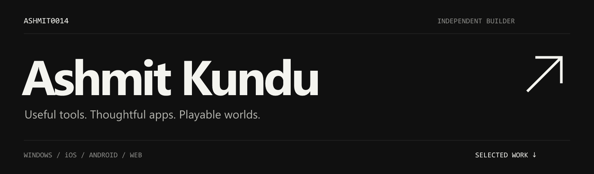
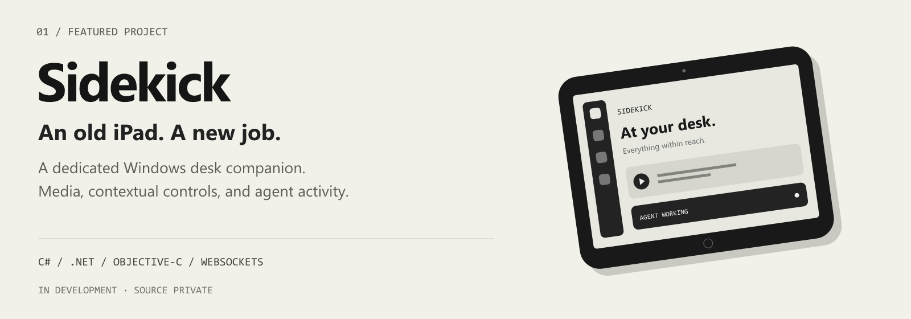
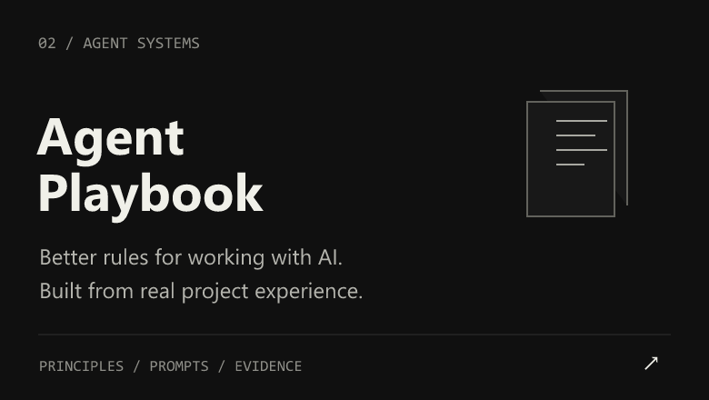
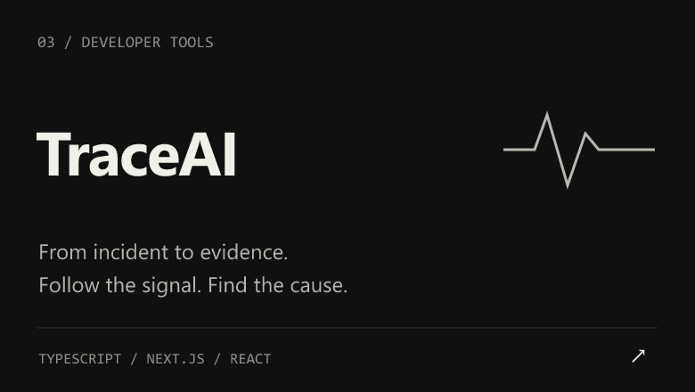
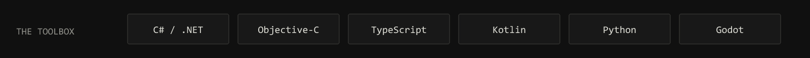

  

  <a href="#selected-work">Selected work</a> &nbsp; / &nbsp;
  <a href="https://github.com/ashmit0014?tab=repositories">Repositories</a> &nbsp; / &nbsp;
  <a href="https://ashmit0014.github.io/agent-playbook/">Read the playbook ↗</a>

 

### Selected work

Built for a first-generation iPad mini running iOS 8 with 512 MB of RAM. A Windows agent and native iOS shell turn it into something worth keeping beside the keyboard.

  
  

 

 

### Other builds

| | |
| :--- | :--- |
| **Cadia** | Android habit tracking for things you want to do, stop, or reduce. |
| **Heartwood** | Each habit becomes a tree, shaped by cumulative practice and recent rhythm. |
| **Bellhollow** | An archived Godot sword-platformer prototype set around a haunted bell tower. |
| **Lanternmarch** | A Godot idle kingdom-builder with procedural art and synthesized audio. |

Earlier experiments in machine learning

- [SAR Flood Detection](https://github.com/ashmit0014/sar-flood-detection) — flood boundaries from Sentinel-1 radar imagery.
- [Hindi Named Entity Recognition](https://github.com/ashmit0014/Hindi-NER-NLP-Project) — multilingual BERT fine-tuned on WikiAnn.
- [Speech Emotion Recognition](https://github.com/ashmit0014/Speech-Emotion-Recognition-Project) — CNNs and audio features on RAVDESS.

