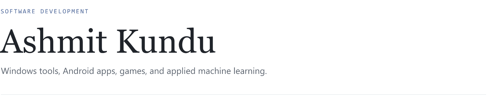
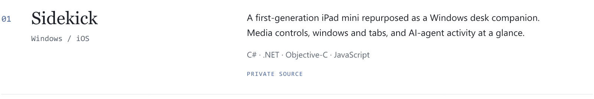
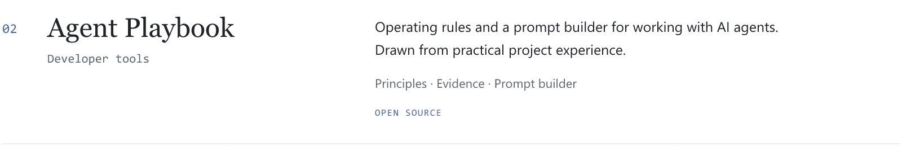
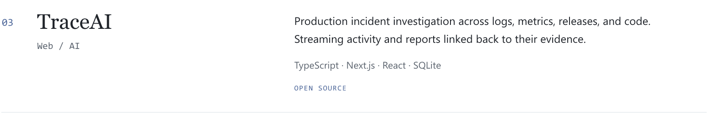

<picture>
  <source media="(max-width: 600px) and (prefers-color-scheme: dark)" srcset="assets/editorial/intro-compact-dark.png" />
  <source media="(max-width: 600px)" srcset="assets/editorial/intro-compact-light.png" />
  <source media="(prefers-color-scheme: dark)" srcset="assets/editorial/intro-dark.png" />
  
</picture>

[Projects](#selected-projects) &nbsp; · &nbsp; [Repositories](https://github.com/ashmit0014?tab=repositories) &nbsp; · &nbsp; [Agent Playbook](https://ashmit0014.github.io/agent-playbook/)

 

### Selected projects

<picture>
  <source media="(max-width: 600px) and (prefers-color-scheme: dark)" srcset="assets/editorial/sidekick-compact-dark.png" />
  <source media="(max-width: 600px)" srcset="assets/editorial/sidekick-compact-light.png" />
  <source media="(prefers-color-scheme: dark)" srcset="assets/editorial/sidekick-dark.png" />
  
</picture>

<a href="https://github.com/ashmit0014/agent-playbook">
  <picture>
    <source media="(max-width: 600px) and (prefers-color-scheme: dark)" srcset="assets/editorial/playbook-compact-dark.png" />
    <source media="(max-width: 600px)" srcset="assets/editorial/playbook-compact-light.png" />
    <source media="(prefers-color-scheme: dark)" srcset="assets/editorial/playbook-dark.png" />
    
  </picture>
</a>

<a href="https://github.com/ashmit0014/traceai">
  <picture>
    <source media="(max-width: 600px) and (prefers-color-scheme: dark)" srcset="assets/editorial/traceai-compact-dark.png" />
    <source media="(max-width: 600px)" srcset="assets/editorial/traceai-compact-light.png" />
    <source media="(prefers-color-scheme: dark)" srcset="assets/editorial/traceai-dark.png" />
    
  </picture>
</a>

### Elsewhere in the projects folder

**Cadia** — Android habit tracking for things to build, stop, or reduce.  
**Heartwood** — an Android habit tracker that represents practice through growing trees.  
**Bellhollow** — an archived 2D sword-platformer prototype.  
**Lanternmarch** — an idle kingdom-builder. Both games use Godot.

Earlier machine learning projects

- [SAR flood detection](https://github.com/ashmit0014/sar-flood-detection) — Sentinel-1 radar imagery and deep learning.
- [Hindi named entity recognition](https://github.com/ashmit0014/Hindi-NER-NLP-Project) — multilingual BERT fine-tuned on WikiAnn.
- [Speech emotion recognition](https://github.com/ashmit0014/Speech-Emotion-Recognition-Project) — CNNs and audio features on RAVDESS.

