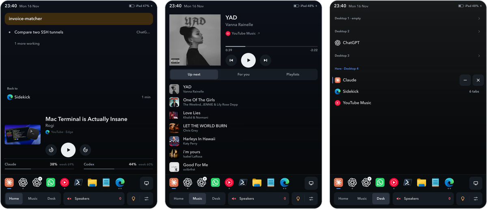

<picture>
  <source media="(max-width: 1100px) and (prefers-color-scheme: dark)" srcset="assets/editorial/intro-compact-dark.png" />
  <source media="(max-width: 1100px)" srcset="assets/editorial/intro-compact-light.png" />
  <source media="(prefers-color-scheme: dark)" srcset="assets/editorial/intro-dark.png" />
  
</picture>

### [Sidekick](https://github.com/ashmit0014/sidekick-ipad)

A 2012 iPad mini turned into a calm control surface for a Windows desk: which AI coding session needs an answer, what is playing, every window by desktop, the room's lights. One touch each, without leaving the main screen.

C# / .NET 10 agent · Objective-C shell on iOS 8 · ES5 page · Edge extension &nbsp; / &nbsp; 263 automated checks &nbsp; / &nbsp; in daily use

### College projects

- [**SAR flood mapping**](https://github.com/ashmit0014/sar-flood-detection) — U-Net segmentation of flood water in Sentinel-1 radar. Validation IoU 0.66.
- [**Hindi named entity recognition**](https://github.com/ashmit0014/hindi-ner) — multilingual BERT fine-tuned on WikiAnn. Test F1 0.91.
- [**Speech emotion recognition**](https://github.com/ashmit0014/speech-emotion-recognition) — a 1-D CNN over audio features on RAVDESS. 58 % over 7 emotions.
